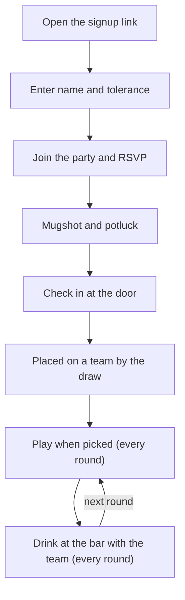
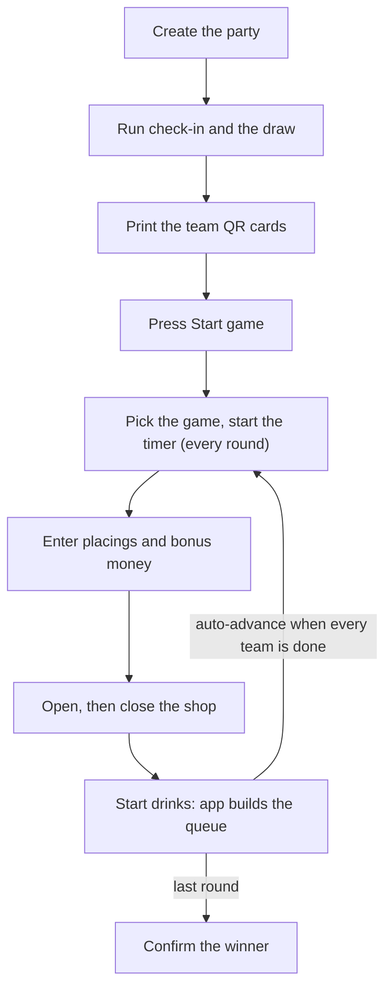
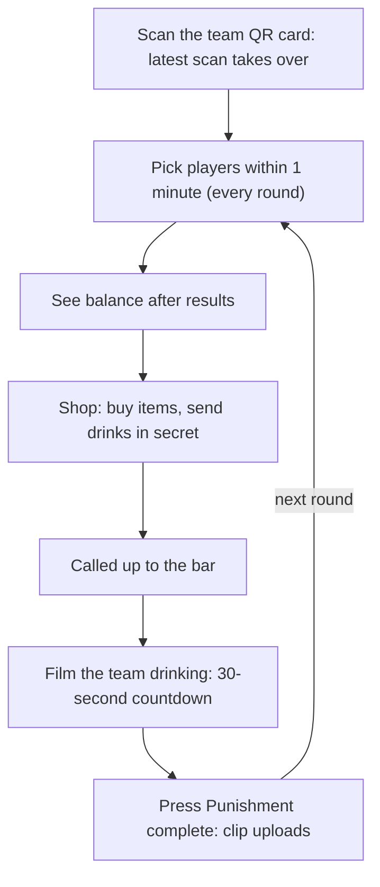
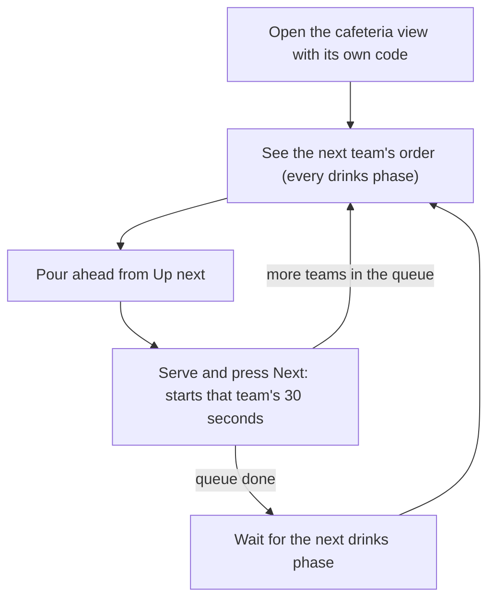
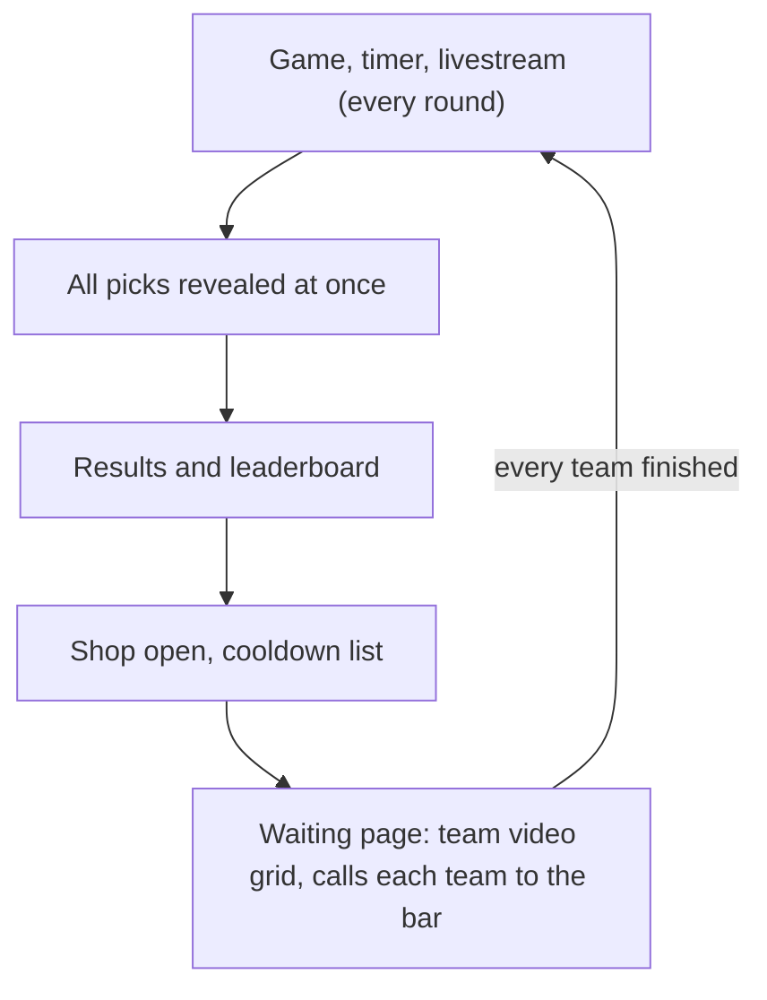
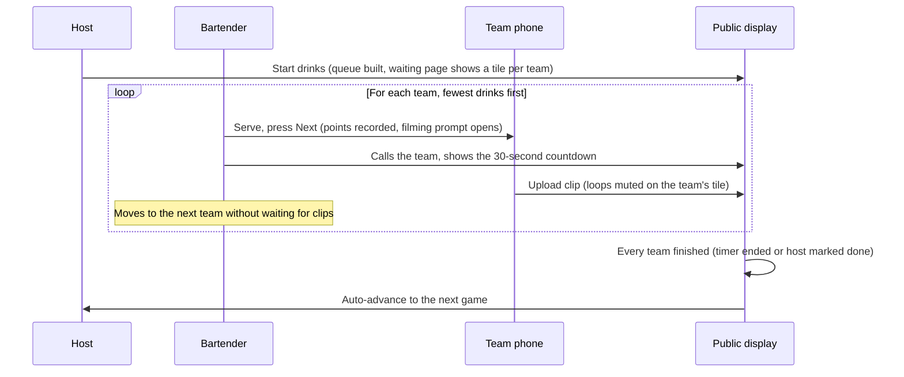

# Halloween Game App: Design and Open Questions

**Source of truth for Phase 2.** Combined from the *Halloween Game App — Software Brief* and *Halloween Game App — Open Questions (Updated)*, as of 4 Nov 2026. It supersedes the earlier Phase 2 design (Days, sentence and commissary, substitutes). Database tables for it are in `docs/schema.md`.

---

## 1. Summary

A web app that runs a team-based Halloween party game. It tracks teams, money, points, items and drinks owed, and shows the live state on screens around the house.

**Goals**

- Everyone, in every room, can see what game is on, who's winning and who owes drinks.
- The host runs each round from one console, with no paper tracking.
- The app enforces the rules (cooldowns, drink order, item limits) so the host doesn't have to remember them.

**Non-goals**

- No user accounts or payments.
- The game livestream runs outside the app.
- The app doesn't judge games. The host enters the results.

---

## 2. Setup and screens

The app is an online web app. All guest, party, team and player data comes from **Phase 1 of the application**, the existing sign-up platform. Nothing is re-entered.

One laptop drives all the public screens. A Lemorele wireless HDMI kit (1 transmitter, 3 receivers) mirrors the laptop's extended display to 1 TV and 2 monitors. A camera operator livestreams the games from a Canon camera.

| View | Where | Who | Shows |
| --- | --- | --- | --- |
| Public display ("waiting page" during drinks) | Laptop's extended display, mirrored to all 3 screens | Everyone | Current phase, game, timer, leaderboard, cooldown list; during drinks, the team video grid |
| Host console | Laptop's own screen | Host | Tabbed admin view (see below) |
| Team phone | One phone per team, claimed by scanning the team's QR code | Whoever holds it | Player picks, balance, shop, secret drink orders, Eye Spy results, filming prompt |
| Cafeteria view | iPad at the bar | Bartender | The current team's order, with Next and Back buttons |

### Host console tabs

The admin view is split into tabs. Proposed tabs:

- **Game control:** phases and results.
- **Teams and phones:** which device is each team's phone and when it took over, plus reissuing a team's QR code.
- **Drink orders:** team orders plus drinks the admin assigns.
- **Drinks required per team:** how many drinks each team must drink this round.
- **Drink prep:** what to pour for the next team heading to the bar.

### Team phones

- **No captain.** Each team has one team phone: whichever device most recently scanned the team's QR code. Whoever holds it acts for the team.
- **Latest scan wins.** When a new device scans the QR code, it becomes the team phone straight away. The previous phone is signed out with a message saying the team has moved to another phone. This covers dead batteries and handovers without the host stepping in.
- **QR codes are printed cards** and never appear on the public screens. Because any scan takes over, a rival who sees a code could hijack that team's phone. If a code leaks, the host issues a new one, which appears on the host console, and the old one stops working.

### Other requirements

- **Live sync:** every view polls the server for the current state about once a second, so changes show up within 1–2 seconds. Timers never depend on polling: the server stores a start or end time, and each device counts down locally. If polling feels slow, the server can send a data-free "something changed" ping over Supabase Realtime Broadcast so views refetch immediately. Phase 1's rule of no database access from the browser still holds.
- **Deadline lock:** orders and purchases lock when the host closes spending. Late orders are rejected.
- **Privacy:** a team phone only ever sees its own team's balance, orders and Eye Spy results.
- **Host override:** the host can view, edit or cancel any team's orders.
- **Network:** every device needs internet access, through the house Wi-Fi (confirmed fine) or mobile data.

### Livestream

A camera operator livestreams the games from a Canon camera. It won't be built into the app. It will run either as a **separate stream on the side** or **through OBS**. If it goes through OBS, the host must never switch the TVs with alt-tab, because that risks showing the host console, including secret orders, on every screen.

---

## 3. Before the game

- Teams, players, tolerance and team balancing all come from Phase 1.
- Tolerance is private and is used only to balance teams.
- The host presses **Start game**. This locks the rosters, generates a QR code for each team and moves to round 1.

### What Phase 1 already provides

Phase 1 lives at [github.com/Happyhamster7/leparty](https://github.com/Happyhamster7/leparty). It is built with Next.js 14 (App Router, TypeScript) and Supabase (Postgres and Storage), and deploys to Vercel. This app should be built as Phase 2 in the same repo.

| This design | Phase 1 today |
| --- | --- |
| Team | `blocks`, created with the event (8 by default, `config.block_count`), each with a name and colour |
| Team QR code | `blocks.join_token` → `/b/<token>`, plus a typed `join_code` at `/join`; printable cards at `/host/<event>/cards` |
| Player | `participants`, one row per person per party, joined to `people` |
| Tolerance | `people.capacity_band` 1–5 (0 standard drinks … "the whole cabinet"), snapshotted to `participants.capacity_snapshot` |
| Team balancing | The draw at check-in: a snake draft by capacity, reviewed on `/host/<event>/draw` |
| Player photo | Mugshots in a private `mugshots` bucket (`participants.photo_path`) |
| Host console | `/host`, protected by a passcode cookie |
| Transaction log | Planned in `docs/schema.md`: balances are never stored, only an append-only `ledger_entries` table |

---

## 4. Round flow

The app works as a state machine. Rounds are grouped into **Acts**, which are groups of games.

| Phase | Host does | App does |
| --- | --- | --- |
| **1. Game** | Picks the game and starts the timer | Prompts each team phone to pick players within 1 minute, with ineligible players greyed out. Reveals all picks at once and shows the game and timer on the screens. |
| **2. Results** | Enters placings and any bonus money | Pays prize money and updates the leaderboard |
| **3. Spending** | Opens and closes the shop | Takes item purchases and secret drink orders from team phones, and checks balances and limits |
| **4. Drinks** | Starts the drinks phase | Resolves Reflect, builds the queue and runs the bar (see section 6). Moves to the next game automatically once every team has finished. |
| ~~Holding cell~~ | *Deferred* | |

### Player selection and cooldown

- Each team phone gets a prompt naming the game and how many players are needed. The team has **1 minute** to choose.
- Anyone on the team can be picked, including whoever holds the phone. Players who played in either of the **last 2 games** are greyed out, with the reason shown.
- Picks stay hidden until every team has confirmed or the minute runs out. They are then revealed on the public screens all at once.
- **If time runs out, the app auto-picks** from eligible players, favouring whoever has played the fewest games.
- Group games skip the prompt: the whole team plays, and no cooldown starts.
- The public screens show who is on cooldown.

---

## 5. Economy and scoring

- **Money** is earned from game placings, bonus awards and stars. It is spent on items and on **sending drinks, which costs money**.
- **Points** are earned for every drink a team sends. They are recorded **when the drink is served**, meaning when the bartender presses Next, not when the order is placed. Points are weighted by drink type.
- **Stars:** the team with the most drinks served at others in a round gets a star. A star is worth an amount of money.
- **Reflected drinks** score for **the team that played Reflect**.
- **Overall winner:** decided — the team with the most points wins, calculated by the system. Points are generated from drinks sent (see above), so sending drinks is the winning move.
- The host can adjust any balance manually, and the reason is logged.

---

## 6. Drinks

### Orders

- During spending, each team places orders from its phone. Each order has a **target team**, a drink type and a quantity.
- **Drinks are sent to a team, never to a named player.** The receiving team decides among themselves who drinks what.
- **Drinks assigned by the admin go into the same queue** as the teams' orders.
- Orders are hidden from other teams and kept off the public screens.
- Per-person drink caps are not enforced by the app and are left to each team's judgement. The house rule still applies: non-drinkers swap to water at the counter, and the drink still scores for the sender.

### Queue and the bar

- The queue always runs **from the fewest drinks owed to the most**. Ties are ordered **randomly**.
- Teams come up one at a time and **drink at the bar** with the bartender.
- The cafeteria iPad shows one team at a time, with totals per drink type.
    - **Decided for now: every team can see who sent each drink.** Senders are shown by default, not hidden — this makes Eye Spy's real-time reveal redundant for now; its remaining value is the round-by-round history view (may revisit). The bartender's iPad still has its own separate "Show senders" toggle for serving purposes, and **resets to hidden for each new order**.
    - **Next** marks the team as served, records the points and calls the next team on the public screens. **Back** reopens the previous team if Next was pressed by mistake.
    - An "up next" preview lets the bartender start pouring ahead.
    - The bartender doesn't wait for videos to upload.
- Large text and big buttons, so it's usable with wet hands in dim light.

### 30-second drink and video

- When the bartender serves a team, **a 30-second countdown starts**. It shows on the team phone and on the waiting page.
- The team phone shows a prompt to **film the team drinking**. Whoever holds it films, then presses **Punishment complete**, which uploads the video.
- A team that doesn't finish its drinks within 30 seconds gets **an extra shot next round**.
- A team counts as finished **when its timer ends, or when the host marks it done**, for example if a video won't upload.

### Waiting page (team video grid)

- During drinks, the public display becomes a grid with **one tile per team**, each showing the team's icon.
- When a team's video is uploaded, it replaces the icon and plays **on a loop, muted**.
- Teams with no drinks this round keep their icon, marked "Safe this round", and count as finished.
- **Auto-advance:** once every team has finished, the app moves straight on to the next game.
- The grid adapts to the number of teams and stays readable on the 24" monitors.
- The host can delete or replace a video.
- **Videos are kept after the party**, so guests should be told they will be filmed.

### Video technical notes

- Videos are filmed with the iPhone's built-in camera through a file input (`accept="video/*" capture`).
- **No conversion.** Clips are stored and played exactly as the iPhone recorded them (HEVC). Vercel can't practically run ffmpeg, so instead **the display laptop is a Mac** (Apple Silicon, M1 or later), whose Safari and Chrome play iPhone video natively and can loop all the tiles at once.
- **Direct upload.** Phones upload straight to Supabase Storage with a signed upload URL issued by the server. Clips never pass through a Vercel function, which can't accept bodies that large.
- Phones record at 1080p and 30 fps on the default "High Efficiency" format, not 4K and not "Most Compatible". That keeps a 30-second clip around 30 MB, under Supabase's 50 MB per-file limit on the free plan.
- Uploads show a progress bar with a Retry option and run in the background.
- **Storage:** clips are kept, so a full night can pass Supabase's free 1 GB. Either use the paid plan or download and clear the clips after the party.

---

## 7. Item shop (placeholders)

These items are **placeholders**. Names, effects and limits will be finalised later. **Pricing model decided:** a single flat price per item, no dynamic scaling — exact values are still TBD.

| Item | Price | Who can buy | Effect | Limit (draft) |
| --- | --- | --- | --- | --- |
| Eye Spy | TBD | Any team | Privately shows a table, round by round since the start of the game, of which team sent drinks to whom and how many | 1 per team per round |
| Reflect | TBD | Any team | All drinks aimed at the buyer this round go back to their senders | 1 per team per night; only 1 Reflect per round across all teams |
| Bus ticket | TBD | Bottom 4 only | Sends one top-team player "on the bus" | 1 per team per night |
| Lock-up | TBD | Bottom 4 only | Sends one top-team player to the holding cell | 1 per team per night |

- The bottom 4 and the top team are worked out from the live leaderboard when spending opens.
- Items that are sold out or used up are greyed out on the team phone.

---

## 8. Game catalogue (placeholders)

This list is a **placeholder**. Formats and rules will be finalised later.

| Game | Format | Group? | Result entered as |
| --- | --- | --- | --- |
| Chinese charades | Team relay | Yes | Placings |
| Chinese dance | All teams | Yes | Host-judged placings |
| Basketball | 1 per team | No | Score or placings |
| Cup shooting | 1 per team | No | Placings |
| Trivia | All teams | Yes | Score per team |
| Cold War drinking | 1 per team | No | Winner |
| Is Jason lying? | 1 per team | No | Correct / wrong per player |
| Dark room cuffs | TBD | TBD | TBD |
| Make Edwin laugh | 1 per team | No | Winner(s) |
| Flip cup | Team relay | Yes | Placings |
| 1 minute chess | Head-to-head | No | Winner per match |
| Lights off you move, lights on you freeze | All players | Yes | Last one standing |

---

## 9. Data model

A transaction log underpins money and points, so any balance can be rebuilt or corrected.

| Entity | Key fields |
| --- | --- |
| Player | id, name, tolerance (from Phase 1), team, status, games played, last game played |
| Team | id, name, colour, icon, QR token, team phone (device id, claimed at), money, points, stars |
| Act | number, name, games |
| Game | id, name, format, is group game, result type |
| Round | number, act, game, phase, participants, placings, pick deadline |
| Drink type | name, points value, cost |
| Drink order | round, sender (team or admin), target team, drink type, qty, status (pending / reflected / served), served at |
| Penalty | round, team, type (e.g. extra shot), reason, applied in round |
| Punishment video | round, team, file, duration, uploaded at, status (pending / shown / removed) |
| Item | name, price, buyer rule, limit per round, limit per night |
| Item use | round, team, item, target, result |
| Transaction | round, team, money change, points change, reason |

---

## 10. Non-functional requirements and scope

- **Online web app** that shares data with Phase 1.
- **Survives a crash:** state autosaves after every action, so a refresh or restart picks up mid-round.
- **Undo:** every host action can be undone or corrected, and is logged.
- **Readable at a distance:** the public display is legible at 1080p on a 24" monitor.
- **Private stays private:** orders and Eye Spy results never appear on public screens.

**MVP (must have for the night)**

- Phase 1 data feeding in, plus Start game
- Tabbed host console and public display
- Team phones: claim by QR (latest scan wins), 1-minute player picks, shop, secret drink orders, video upload
- Cafeteria iPad view with Next and Back
- Drinks queue (fewest first, random tiebreak, admin drinks included), 30-second timer, extra-shot penalty
- Waiting page with looping muted videos and auto-advance
- Money, points (on serve), stars, leaderboard
- Cooldown tracking
- Item shop with placeholder items

**Deferred**

- Holding cell, including late or no-cosplay guests and cell games
- "On the bus", which will be a set of punishments
- Final items, prices and limits
- Game rules and formats
- Party extras: potluck wanted board, and the comedy, trivia and charades segment

---

## 11. Open questions

**Build**

- [ ] How much build time is left, and who is building it? (Stack settled: Next.js 14 and Supabase on Vercel, as in Phase 1.)
- [ ] Player cooldowns conflict with the repo rule "don't add caps, cooldowns or confirmation prompts". Was that rule meant for drinks only?
- [ ] One active team phone (latest scan signs the others out) conflicts with the repo's "multiple devices per block are normal". Which should win?
- [ ] `blocks.captain_participant_id` exists but this design has no captain. Remove it, or leave it unused?
- [ ] Livestream: separate stream on the side, or through OBS?

**Structure**

- [ ] How many Acts and rounds? Does the night end on a set round or at a set time?
- [ ] Final list of host console tabs.
- [ ] Can the host also press Next on the drinks queue, or only the bartender? Only the bartender is recommended, so the two screens can't fall out of step.

**Scoring and economy**

- [ ] List of drink types, plus the points and cost for each.
- [ ] Prize money for each placing.
- [ ] How much money a star is worth.
- [ ] What earns bonus money (best cosplay, host's pick, other).

**Penalties**

- [ ] Besides the extra shot for not finishing in 30 seconds, what other penalties can the admin apply, what do they do, and is there a limit?

### Resolved

| Question | Decision |
| --- | --- |
| Who acts for a team? | No captain. The latest device to scan the team QR is the team phone. |
| QR hand-out | Printed cards. A leaked code is reissued on the host console. |
| Drink targeting | Teams only. The team decides who drinks. |
| Where drinks happen | At the bar with the bartender, 30 seconds per team, filmed on the team phone |
| Timer start | When the bartender serves the team |
| Not finishing in time | An extra shot next round |
| When a team is "finished" | Its timer ends, or the host marks it done |
| After drinks | Auto-advance to the next game |
| Videos after the party | Kept |
| Does the bartender wait for videos? | No |
| Show-senders toggle | Resets to hidden for each order |
| Drink caps and water swaps | Team judgement, with water swaps at the counter |
| Admin-assigned drinks | Go into the same queue as team orders |
| "Drinks required per team" | The number of drinks a team must drink |
| Pick timeout | The app auto-picks, favouring whoever has played the fewest games |
| Eye Spy | A round-by-round table, from the start of the game, of who sent drinks to whom and how many |
| Sending a drink costs money? | Yes |
| Points awarded | On serve |
| Reflected drinks score for | The team that played Reflect |
| Queue tiebreak | Random |
| Overall winner | Most points, calculated by the system |
| Sender visibility | Shown to every team by default, for now — not hidden |
| Item pricing model | A single flat price per item; exact values still TBD |
| Guests, teams, players, tolerance | All from Phase 1 |
| Wi-Fi | Works |
| Hosting | Online web app |
| Source of truth | This document. It replaces the Phase 2 design in the repo's `CLAUDE.md` and `docs/schema.md` (Days, sentence and commissary, substitutes). |
| Stack | Next.js 14 and Supabase on Vercel, as in Phase 1 |

---

## 12. User workflows

What each person does, start to finish. Steps marked *(every round)* repeat until the night ends.

### Guest (their own phone, Phase 1)

### Host (laptop, tabbed console)

Any time: add admin drinks, adjust balances, mark a team done, reissue a leaked QR code.

### Team phone (whoever last scanned the team's QR)

### Bartender (cafeteria iPad)

Back undoes a mistaken Next.

### Public display (TV and 2 monitors)

### Drinks phase hand-offs

The one place everyone hands off to each other. Only the host and the bartender press anything to move the night on; the public display reacts on its own.

Each team's 30 seconds starts when the bartender presses Next, not when filming starts. A team that doesn't finish in time gets an extra shot next round.
